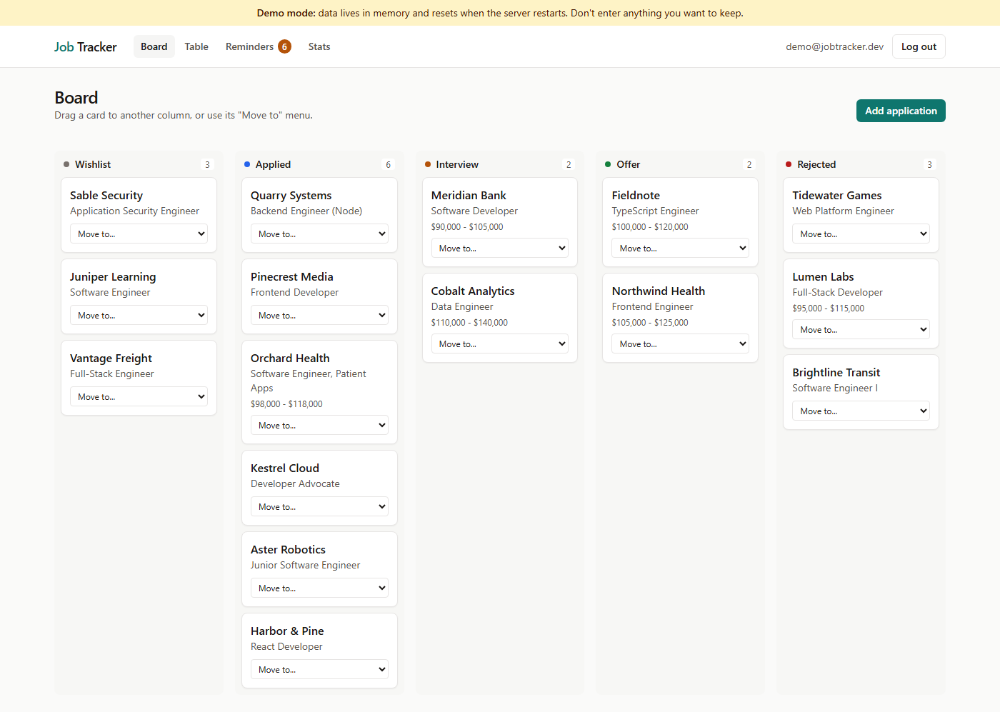
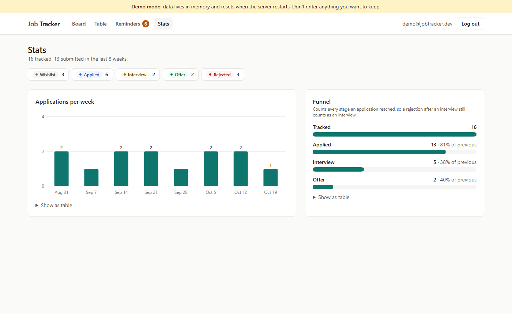

# Job Tracker

A private place to keep track of a job search. You add the jobs you are interested in or have applied to, move them along as things happen (applied, interview, offer, rejected), and the app reminds you when someone hasn't replied in a while. It also shows how many applications you send each week and how many turn into interviews and offers.

Each person has their own account, and nobody can see anyone else's applications.

**Live demo:** https://job-tracker-ten-tawny.vercel.app

| Demo account | |
| --- | --- |
| Email | `demo@jobtracker.dev` |
| Password | `jobhunt-demo-2026` |

The credentials are also shown on the log-in page. The demo has no database attached, so it runs on an in-memory copy of Postgres and **its data resets**. A banner on every page says so. See [Limitations](#limitations) for what that means in practice.



## What you can do

- **Sign up and log in** with an email and password.
- **Track applications**: company, role, posting link, status, salary range, notes, applied date and follow-up date.
- **Board view**: drag a card to another column. Every card also has a "Move to" menu, so the board works with the keyboard, a screen reader or a touch screen. Columns a card can't move to fade out while you drag.
- **Table view**: sort by any column and filter by status or a search on company and role. Filters live in the URL, so a filtered view can be bookmarked.
- **Timeline**: every status change is recorded with its date, shown on the application's page.
- **Reminders**: an application with no status change for 10 days shows up as "No response in N days". Setting a follow-up date overrides that rule. "Snooze 3 days" and "I followed up" (10 more days) push the reminder out.
- **Stats**: applications submitted per week for the last eight weeks, and a funnel from tracked to applied to interview to offer, both drawn as hand-made SVG. Each chart has a "Show as table" view.
- **CSV export** of all your applications.



## The status rules

Applications move forward through the pipeline. The same rules apply on the board, in the edit form and on the server.

| From | Can move to |
| --- | --- |
| Wishlist | Applied, Interview, Offer |
| Applied | Interview, Offer, Rejected |
| Interview | Offer, Rejected |
| Offer | Rejected (for example, you declined) |
| Rejected | Applied (they came back to you) |

Skipping ahead is allowed. Going backwards is not, apart from reopening a rejected application. Something still on the wishlist can't be "rejected", since it was never sent. The rules live in one file, [`src/lib/status.ts`](src/lib/status.ts), with its own tests.

The funnel counts every stage an application *reached*, read from its timeline, not just where it is now. An application that got an interview and was then rejected still counts as an interview. Otherwise the funnel would understate how far you actually got.

## Security model

This was the part I cared most about getting right, so here is exactly how it works.

### Passwords

- Hashed with **bcrypt** (`bcryptjs`, cost factor 12). The plain password is never stored or logged.
- Passwords must be at least 10 characters and at most **72 bytes**. bcrypt silently ignores everything after byte 72, so a longer password would give a false sense of strength. The check counts bytes, not characters: 25 euro signs is 75 bytes and is rejected.
- Log-in returns the same message ("Email or password is incorrect.") for an unknown email and a wrong password. For an unknown email it still runs a bcrypt comparison against a dummy hash, so the response time doesn't reveal whether the account exists either.
- Log-in attempts are throttled to 10 per email per 15 minutes.

### Sessions

I wrote a small session system instead of pulling in Auth.js. It is about 100 lines in [`src/server/auth.ts`](src/server/auth.ts) and [`src/server/session.ts`](src/server/session.ts), and every part of it is tested.

- On log-in the server generates 32 random bytes as the session token and puts it in a cookie.
- The database stores only the **SHA-256 hash** of the token. Someone holding a copy of the database can't turn a row back into a working cookie (there is a test for exactly that).
- The cookie is `HttpOnly` (page scripts can't read it), `SameSite=Lax`, and in production `Secure` with the `__Host-` prefix. That prefix makes the browser refuse the cookie unless it is HTTPS-only, has path `/` and no `Domain`, so a subdomain can't set or read it.
- Sessions last 30 days and slide: using the app in the second half of that window extends it. The database row is the source of truth for expiry. Log-out deletes the row, so the old cookie stops working at once.
- CSRF: Server Actions only accept POSTs whose `Origin` matches the host (built into Next.js), and the cookie isn't sent on cross-site POSTs anyway.

With a real database there is no signing secret to manage, because sessions are database rows.

**Demo mode is different, on purpose.** Without a database, every Vercel serverless instance has its own in-memory copy of Postgres. A session row written by one instance doesn't exist on the next, and the first version of this app logged demo visitors out after one click. In demo mode the cookie is instead a signed token, `d.<userId>.<expiry>.<HMAC-SHA256>`, which any instance can check with the shared `AUTH_SECRET` ([`src/server/demo-session.ts`](src/server/demo-session.ts)). The demo account is seeded with the same fixed ids on every instance, so its token and its links work everywhere. The trade-off is that a demo token can't be revoked on the server: log-out clears the cookie, but a copied token stays valid until it expires. That is fine for throwaway demo data. When `DATABASE_URL` is set, these tokens are refused outright and only database sessions count.

### Per-user authorization

Every function that reads or writes applications takes the signed-in user's id and puts it in the `WHERE` clause, next to the record id. There is no "get by id" without a user id, so a forgotten ownership check doesn't compile. The user id always comes from the session cookie, never from the browser.

When a record belongs to someone else, the answer is the same "not found" as for an id that doesn't exist. Probing ids tells an attacker nothing.

[`src/server/authorization.test.ts`](src/server/authorization.test.ts) signs in as Alice and goes after Bob's application through every entry point: get, list, search, filter, update, move, set follow-up, delete, CSV export, stats and reminders. Each attempt must fail with not-found, or return none of Bob's data. Afterwards the test checks that Bob's row and timeline are unchanged and that the table holds exactly the rows it held before. The Playwright suite repeats the check through the real UI and HTTP: a second user opening the first user's application URL gets a 404, and their export doesn't contain it.

### Other hardening

- All input goes through **zod** on the server, including the arguments of Server Actions, which are public HTTP endpoints.
- Posting links must be `http:` or `https:`, so a saved link can never be `javascript:...`.
- **CSV injection**: a cell that starts with `=`, `+`, `-` or `@` gets a leading apostrophe. A company named `=HYPERLINK(...)` shows up as text in Excel instead of running.
- Search text is escaped before it goes into `ILIKE`, so `%` and `_` match themselves.
- Malformed ids get a 404 instead of a database error.
- The app sends `X-Frame-Options: DENY`, `nosniff`, a strict referrer policy and a locked-down permissions policy.

## Data model

```
users           id, email (unique, lowercased), name, password_hash, created_at
sessions        token_hash (PK, SHA-256), user_id -> users, expires_at, created_at
applications    id, user_id -> users, company, role, link, status, salary_min, salary_max,
                notes, applied_on, follow_up_on, status_changed_at, created_at, updated_at
                CHECK (salary_min <= salary_max)
status_events   id, application_id -> applications, user_id -> users,
                from_status (null for the first event), to_status, changed_at
```

`status` is a Postgres enum. Deleting a user removes their sessions, applications and events (`ON DELETE CASCADE`). `status_events` is append-only: a status change and its event are written in one transaction, and a refused move writes neither. Reminders and stats are computed when you open the page, not stored.

The schema is in [`src/db/schema.ts`](src/db/schema.ts). Migrations are generated by drizzle-kit into [`drizzle/`](drizzle).

## How it is built

- **Next.js 15.5** (App Router) with **Server Actions** for every change and a route handler for the CSV download.
- **Drizzle ORM** over **Postgres**. With `DATABASE_URL` set it uses `postgres.js`. Without it, it uses **PGlite**, which is real Postgres compiled to WebAssembly. That is how the demo and the tests run with no database server. Both run the same SQL migrations.
- **Tailwind CSS 4**. No component library. The charts are plain SVG.
- The data layer (`src/server/`) takes the database handle as an argument, so tests pass in a throwaway database and pages pass in the real one.

Why Drizzle and not Prisma: I wanted one code path that runs on both PGlite and Postgres, and Drizzle's PGlite driver does that today without a preview feature.

```
src/
  app/(auth)/      log-in, sign-up and their Server Actions
  app/(app)/       board, table, detail, edit, reminders, stats and their Server Actions
  app/export/      GET /export  (CSV download)
  components/      board, forms, charts, timeline
  db/              schema, connection (Postgres or PGlite), demo seed
  lib/             pure logic: status rules, validation, dates, CSV, stats
  server/          auth, sessions, user-scoped queries, reminders, stats, export
e2e/               Playwright tests
```

## Tests

| Suite | What it covers | Count |
| --- | --- | --- |
| Vitest, `src/lib` | status rules, validation, dates, CSV escaping, stats math, formatting | 27 |
| Vitest, `src/server` + `src/db` | auth and sessions, signed demo tokens, application queries, timeline, reminders, demo seed, and the cross-user authorization suite | 47 |
| Playwright, `e2e/` | sign up, add, move (menu and drag and drop), timeline, CSV export, edit validation, refused moves, cross-user 404, demo log-in, log-out | 7 |

The database tests run twice in CI: once on in-memory PGlite and once on a real **Postgres 17** service container. On Postgres each test file creates and drops its own database, so files can run in parallel.

CI ([`.github/workflows/ci.yml`](.github/workflows/ci.yml)) runs lint, typecheck, both unit-test jobs, a production build, `npm audit --omit=dev` (must be clean) and `npm audit --audit-level=high`, then the Playwright suite in the official `mcr.microsoft.com/playwright:v1.55.1-noble` container.

```bash
npm test             # unit and integration tests on PGlite
DATABASE_URL=postgres://... npm test   # the same tests on your Postgres
npm run build && npm run test:e2e      # Playwright, on port 47260 with a fresh in-memory database
```

## Run it yourself

You need Node 22 (see `.nvmrc`).

**Without a database** (quickest):

```bash
npm install
npm run dev
```

Open http://localhost:3000 and log in with the demo account above. Data is kept in a local `.pglite/` folder, so it survives restarts. Delete the folder to start over. Set `PGLITE_IN_MEMORY=1` to keep nothing at all.

**With Postgres**:

```bash
cp .env.example .env.local                  # set DATABASE_URL for the app
DATABASE_URL=postgres://... npm run db:migrate   # create the tables (drizzle-kit reads the shell env)
npm run dev
```

With a real database the demo banner, demo credentials and demo seed are switched off. You create your own account with Sign up.

Environment variables (all optional):

| Variable | Effect |
| --- | --- |
| `DATABASE_URL` | Postgres connection string. Without it the app uses PGlite and runs in demo mode. |
| `AUTH_SECRET` | Demo mode only: the key (32+ characters) that signs demo session tokens. Needed when the demo runs on more than one instance, as on Vercel. Locally a random key is made per process. |
| `BCRYPT_COST` | bcrypt work factor, default 12. The tests set it to 4 to run faster. |
| `PGLITE_IN_MEMORY=1` | Keep PGlite in memory instead of `.pglite/`. |

## Limitations

- **The live demo can lose your changes.** It has no database, so every Vercel serverless instance boots its own in-memory Postgres with a fresh copy of the demo data. Two requests can land on different instances. The demo account stays logged in everywhere (see [Sessions](#sessions)), but an application you just added or moved may be missing on the next page if that page came from another instance. An account you sign up for exists only on the instance that created it, so you may get sent back to the log-in page. Instances also shut down when idle, which resets everything. Setting `DATABASE_URL` to a hosted Postgres (Neon, Supabase and so on) fixes all of this, with no code changes.
- The first request after a cold start takes a few seconds while PGlite boots and seeds the demo.
- The log-in throttle is kept in memory, per instance. A multi-instance deployment should move it to Redis or a table.
- Dates are calendar days in UTC. Around midnight, "today" can differ from your local date by one.
- Salaries are whole US dollars per year. There is no currency field.
- No email verification or password reset. Both need an email provider, which this project doesn't have.

## License

MIT, see [LICENSE](LICENSE).
